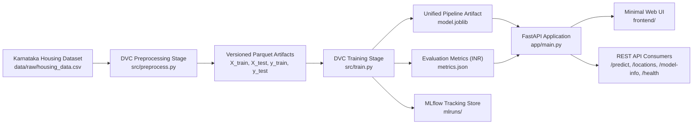

# HOMESTEAD — House Price Prediction (Karnataka)

An end-to-end Machine Learning Operations (MLOps) system for residential property valuation in Karnataka, India. HOMESTEAD combines automated data versioning via DVC, reproducible XGBoost pipeline training, experiment tracking with MLflow, FastAPI backend serving, a minimal beginner-friendly web interface in Indian Rupees (₹), containerization with Docker, and automated CI/CD via GitHub Actions.

---

## 1. Project Overview & Architecture

HOMESTEAD models residential property values based on structural attributes (area in sq ft, bedrooms, bathrooms) and Karnataka city market dynamics using a hedonic pricing framework denominated in Indian Rupees (₹). The system is architected around strict operational reproducibility: feature engineering and transformations are bundled directly with the estimator in a unified scikit-learn inference pipeline to guarantee zero training-serving skew.

### System Architecture Flow



---

## 2. Technology Stack

- **Machine Learning**: XGBoost (`XGBRegressor`), scikit-learn (`ColumnTransformer`, `StandardScaler`, `OneHotEncoder`, `SimpleImputer`, `Pipeline`).
- **Data Versioning & Pipelines**: DVC (Data Version Control) with multi-stage dependencies (`dvc.yaml`).
- **Experiment Tracking**: MLflow (parameters, metrics in INR, pipeline models, and run tags).
- **Backend API**: FastAPI, Uvicorn, Pydantic v2 (Lifespan management, strict schema validation, CORS).
- **Storage & Artifacts**: Apache Parquet, Joblib serialization, JSON metrics.
- **Testing**: pytest (unit testing, endpoint tests, differential city validation, synthetic end-to-end training fixture).
- **Frontend**: Clean, minimal, responsive interface styled in warm ivory and subtle sage-green accents.

---

## 3. Directory Structure

```
house-price-prediction/
├── .github/
│   └── workflows/
│       └── ci-cd.yaml          # GitHub Actions automated test & Docker build workflow
├── app/
│   ├── __init__.py
│   └── main.py                 # FastAPI application with /predict, /health, /locations, /model-info
├── data/
│   ├── raw/
│   │   └── housing_data.csv    # Source Karnataka housing dataset (INR)
│   └── processed/
│       ├── X_train.parquet     # Imputed, scaled, and encoded training features
│       ├── X_test.parquet      # Imputed, scaled, and encoded testing features
│       ├── y_train.parquet     # Training target labels (INR)
│       ├── y_test.parquet      # Testing target labels (INR)
│       └── preprocessor.joblib # Fitted ColumnTransformer
├── frontend/
│   ├── index.html              # Minimal house price prediction interface
│   ├── styles.css              # Warm ivory and sage-green responsive styling
│   └── app.js                  # Form validation and API communication
├── src/
│   ├── __init__.py
│   ├── generate_data.py        # Reproducible Karnataka hedonic housing data generator
│   ├── preprocess.py           # Preprocessing pipeline and train/test split
│   └── train.py                # XGBoost training, MLflow tracking, pipeline packaging
├── tests/
│   ├── __init__.py
│   ├── test_api.py             # Endpoint tests, INR formatting, city differential tests
│   ├── test_preprocessing.py   # Transformer, imputation, and column mapping tests
│   └── test_training.py        # End-to-end training test on synthetic fixture
├── Dockerfile                  # Containerization image with non-root security
├── .dockerignore               # Container build exclusions
├── .gitignore                  # Git tracking exclusions
├── dvc.yaml                    # DVC pipeline stages (preprocess, train)
├── dvc.lock                    # DVC pipeline state hash lock
├── params.yaml                 # Configurable hyperparameters for DVC stages
├── model.joblib                # Persisted single-inference pipeline
├── metrics.json                # Latest evaluation metrics and metadata in INR
├── requirements.txt            # Pinned Python package dependencies
└── README.md                   # Comprehensive documentation
```

---

## 4. Dataset Specification & Karnataka Locations

The pipeline expects CSV data with the following schema:

| Column | Type | Description | Constraints |
| :--- | :--- | :--- | :--- |
| `sqft` | Float / Int | Interior living area in square feet | 101 – 24,999 sq ft |
| `bedrooms` | Integer | Total count of bedrooms | 1 – 20 |
| `bathrooms` | Float | Full and half bathroom count | 0.5 – 15.0 |
| `location` | String | Supported Karnataka city | 12 Karnataka cities |
| `price` | Float | Residential transaction value (target) | Indian Rupees (INR - ₹) |

### Supported Locations in Karnataka

1. **Bengaluru** (Metropolitan capital and primary IT hub)
2. **Mysuru** (Heritage city and secondary IT center)
3. **Mangaluru** (Coastal port and commercial hub)
4. **Hubballi-Dharwad** (Commercial & educational hub of North Karnataka)
5. **Belagavi** (Border manufacturing and commercial city)
6. **Kalaburagi** (Regional center of North Karnataka)
7. **Davanagere** (Central Karnataka commercial hub)
8. **Shivamogga** (Malnad regional center)
9. **Tumakuru** (Industrial corridor city)
10. **Udupi** (Coastal educational and temple hub)
11. **Hassan** (Agricultural and regional industrial hub)
12. **Ballari** (Industrial and regional center)

### Dataset Honesty & Limitations

- **Synthetic Calibration**: The initial dataset `data/raw/housing_data.csv` is generated by `src/generate_data.py` using hedonic valuation economics calibrated to Karnataka real-estate price tiers in Indian Rupees.
- **Demonstration Estimates**: Predictions produced by this application are demonstration estimates for educational and prototype purposes, **not verified professional appraisals or live market valuations**.
- **Location Influence**: Different cities receive distinct valuations for the exact same property dimensions (e.g., a 1,500 sq ft house in Bengaluru is valued significantly higher than in Kalaburagi).

---

## 5. How to Retrain the Model

### Option A: Via DVC Pipeline (Recommended)

To reproduce the entire preprocessing and training pipeline deterministically:

```powershell
.\venv\Scripts\dvc.exe repro
```

To view updated metrics:

```powershell
.\venv\Scripts\dvc.exe metrics show
```

### Option B: Standalone Step-by-Step Execution

1. **(Optional) Regenerate Dataset:**
   ```powershell
   .\venv\Scripts\python.exe src/generate_data.py --samples 2500 --seed 42
   ```

2. **Preprocess and Generate Parquet Splits:**
   ```powershell
   .\venv\Scripts\python.exe src/preprocess.py --config params.yaml
   ```

3. **Train XGBoost Model and Save `model.joblib`:**
   ```powershell
   .\venv\Scripts\python.exe src/train.py --config params.yaml
   ```

---

## 6. How to Run the Application in VS Code

### Step 1: Open Project in VS Code
Open the project directory in VS Code:
```powershell
code "C:\Users\user\OneDrive\Desktop\House price prediction"
```

### Step 2: Select the Python Interpreter
1. Press `Ctrl + Shift + P` (or `Cmd + Shift + P` on Mac) to open the Command Palette.
2. Search and select: **`Python: Select Interpreter`**.
3. Choose the project virtual environment: `.\venv\Scripts\python.exe`.

### Step 3: Run the FastAPI Server
Open an integrated PowerShell terminal in VS Code (`Ctrl + ` `) and run:

```powershell
.\venv\Scripts\uvicorn.exe app.main:app --host 0.0.0.0 --port 8000 --reload
```

### Step 4: Open the Web Interface
Open your web browser and navigate to:
- **Web Interface**: [http://localhost:8000/ui/](http://localhost:8000/ui/)
- **Interactive Swagger Docs**: [http://localhost:8000/docs](http://localhost:8000/docs)
- **Health Check**: [http://localhost:8000/health](http://localhost:8000/health)

---

## 7. API Reference & Examples

### 1. API Status — `GET /`

```bash
curl -X GET "http://localhost:8000/"
```

**Response (`200 OK`):**
```json
{
  "status": "online",
  "service": "HOMESTEAD Property Valuation MLOps API (Karnataka, India)",
  "version": "1.0.0",
  "currency": "INR",
  "model_loaded": true,
  "docs_url": "/docs",
  "ui_url": "/ui/",
  "timestamp": "2026-10-12T16:57:02.913555+00:00"
}
```

### 2. Readiness Check — `GET /health`

```bash
curl -X GET "http://localhost:8000/health"
```

**Response (`200 OK`):**
```json
{
  "status": "healthy",
  "ready": true,
  "model_path": "model.joblib",
  "timestamp": "2026-10-12T16:57:02.919516+00:00"
}
```

### 3. House Price Prediction — `POST /predict`

#### Example A: Bengaluru (1,500 sq ft, 3 Beds, 2 Baths)

```bash
curl -X POST "http://localhost:8000/predict" \
     -H "Content-Type: application/json" \
     -d '{
       "sqft": 1500.0,
       "bedrooms": 3,
       "bathrooms": 2.0,
       "location": "Bengaluru"
     }'
```

**Response (`200 OK`):**
```json
{
  "predicted_price": 16234757.0,
  "formatted_price": "₹1,62,34,757",
  "currency": "INR",
  "property_details": {
    "sqft": 1500.0,
    "bedrooms": 3,
    "bathrooms": 2.0,
    "location": "Bengaluru",
    "neighborhood": "Bengaluru",
    "price_per_sqft": 10823.17,
    "formatted_price_per_sqft": "₹10,823/sq ft"
  },
  "summary": "Valuation estimate for a 1,500 sq ft, 3 bed, 2 bath residence in Bengaluru.",
  "model_version": "XGBRegressor",
  "timestamp": "2026-10-12T16:57:29.104000+00:00",
  "price_per_sqft": 10823.17,
  "formatted_price_per_sqft": "₹10,823/sq ft",
  "disclaimer": "Demonstration estimate based on statistical modeling, not a verified market valuation."
}
```

#### Example B: Mysuru (Same property: 1,500 sq ft, 3 Beds, 2 Baths)

```bash
curl -X POST "http://localhost:8000/predict" \
     -H "Content-Type: application/json" \
     -d '{
       "sqft": 1500.0,
       "bedrooms": 3,
       "bathrooms": 2.0,
       "location": "Mysuru"
     }'
```

**Response (`200 OK`):**
```json
{
  "predicted_price": 9723148.0,
  "formatted_price": "₹97,23,148",
  "currency": "INR",
  "property_details": {
    "sqft": 1500.0,
    "bedrooms": 3,
    "bathrooms": 2.0,
    "location": "Mysuru",
    "neighborhood": "Mysuru",
    "price_per_sqft": 6482.1,
    "formatted_price_per_sqft": "₹6,482/sq ft"
  },
  "summary": "Valuation estimate for a 1,500 sq ft, 3 bed, 2 bath residence in Mysuru.",
  "model_version": "XGBRegressor",
  "timestamp": "2026-10-12T16:57:29.130000+00:00",
  "price_per_sqft": 6482.1,
  "formatted_price_per_sqft": "₹6,482/sq ft",
  "disclaimer": "Demonstration estimate based on statistical modeling, not a verified market valuation."
}
```

---

## 8. Automated Testing

Run the automated test suite with pytest:

```powershell
.\venv\Scripts\pytest.exe tests/ -v
```

All 16 unit, integration, and endpoint tests pass, covering:
- API readiness, status, and `/locations` endpoints
- Prediction responses in INR formatting
- Backward compatibility for `neighborhood` alias
- City price differential validation (e.g. Bengaluru vs Kalaburagi)
- Input schema validation rejections (HTTP 422)
- Missing model handling (HTTP 503)
- ColumnTransformer preprocessing and missing-value imputation
- End-to-end model training on synthetic test fixtures
