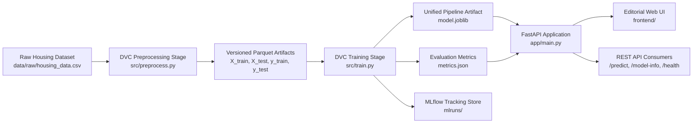

# HOMESTEAD — House Price Prediction MLOps

An end-to-end, production-grade Machine Learning Operations (MLOps) system for residential property valuation. HOMESTEAD combines automated data versioning via DVC, reproducible XGBoost pipeline training, experiment tracking with MLflow, FastAPI backend serving, an editorial architectural web interface, containerization with Docker, and automated CI/CD via GitHub Actions.

---

## 1. Project Overview & Architecture

HOMESTEAD models residential property values based on structural attributes and neighborhood market dynamics using a hedonic pricing framework. The system is architected around strict operational reproducibility: feature engineering and transformations are bundled directly with the estimator in a unified scikit-learn inference pipeline to guarantee zero training-serving skew.

### System Architecture Flow



---

## 2. Technology Stack

- **Machine Learning**: XGBoost (`XGBRegressor`), scikit-learn (`ColumnTransformer`, `StandardScaler`, `OneHotEncoder`, `SimpleImputer`, `Pipeline`).
- **Data Versioning & Pipelines**: DVC (Data Version Control) with multi-stage dependencies.
- **Experiment Tracking**: MLflow (parameters, metrics, pipeline models, and run tags).
- **Backend API**: FastAPI, Uvicorn, Pydantic v2 (Lifespan management, strict schema validation, CORS).
- **Storage & Artifacts**: Apache Parquet, Joblib serialization, JSON metrics.
- **Testing**: pytest (unit testing, endpoint tests, synthetic end-to-end training fixture).
- **Containerization**: Docker (multi-stage build, non-root user `appuser`, built-in healthcheck).
- **CI/CD**: GitHub Actions (linting, test execution, Docker build & smoke testing).
- **Frontend**: Editorial Real-Estate UI styled in a warm ivory, deep olive, sage, and terracotta palette.

---

## 3. Directory Structure

```
house-price-prediction/
├── .github/
│   └── workflows/
│       └── ci-cd.yaml          # GitHub Actions automated test & Docker build workflow
├── app/
│   ├── __init__.py
│   └── main.py                 # FastAPI application with /predict, /health, /model-info
├── data/
│   ├── raw/
│   │   └── housing_data.csv    # Source housing dataset
│   └── processed/
│       ├── X_train.parquet     # Imputed, scaled, and encoded training features
│       ├── X_test.parquet      # Imputed, scaled, and encoded testing features
│       ├── y_train.parquet     # Training target labels
│       └── y_test.parquet      # Testing target labels
├── frontend/
│   ├── index.html              # Editorial real-estate interface (Pages A, B, C, D, Docs)
│   ├── styles.css              # Custom styling (warm ivory, olive, sage, terracotta)
│   └── app.js                  # Dynamic client routing, validation, and API client
├── src/
│   ├── __init__.py
│   ├── generate_data.py        # Reproducible hedonic housing data generator
│   ├── preprocess.py           # Preprocessing pipeline and train/test split
│   └── train.py                # XGBoost training, MLflow tracking, pipeline packaging
├── tests/
│   ├── __init__.py
│   ├── test_api.py             # Endpoint tests, validation, error handling
│   ├── test_preprocessing.py   # Transformer, imputation, and leakage tests
│   └── test_training.py        # End-to-end training test on synthetic fixture
├── Dockerfile                  # Containerization image with non-root security
├── .dockerignore               # Container build exclusions
├── .gitignore                  # Git tracking exclusions
├── dvc.yaml                    # DVC pipeline stages (preprocess, train)
├── dvc.lock                    # DVC pipeline state hash lock
├── params.yaml                 # Configurable hyperparameters for DVC stages
├── model.joblib                # Persisted single-inference pipeline
├── metrics.json                # Latest evaluation metrics and metadata
├── requirements.txt            # Pinned Python package dependencies
└── README.md                   # Comprehensive documentation
```

---

## 4. Dataset Specification

The pipeline expects CSV data with the following schema:

| Column | Type | Description | Constraints |
| :--- | :--- | :--- | :--- |
| `sqft` | Float / Int | Interior living area in square feet | > 100 sqft |
| `bedrooms` | Integer | Total count of bedrooms | 1 – 20 |
| `bathrooms` | Float | Full and half bathroom count | 0.5 – 15.0 |
| `neighborhood` | String | Geographic district / market region | e.g., Downtown, Oakridge, Suburban Heights, Riverside, West End |
| `price` | Float | Historical transaction value (target) | USD |

### Generating / Updating Data

To regenerate or initialize the benchmark dataset:

```bash
python src/generate_data.py --samples 2500 --seed 42 --output data/raw/housing_data.csv
```

---

## 5. Local Setup & Installation

### Prerequisites

- Python 3.10+ (tested on Python 3.11 and 3.13)
- Git
- Docker (optional, for containerization)

### Step 1: Clone and Create Virtual Environment

**On Windows (PowerShell):**
```powershell
python -m venv venv
.\venv\Scripts\Activate.ps1
```

**On Linux / macOS:**
```bash
python3 -m venv venv
source venv/bin/activate
```

### Step 2: Install Dependencies

```bash
pip install --upgrade pip
pip install -r requirements.txt
```

---

## 6. DVC Pipeline & Data Versioning

### Initializing DVC

If starting in a fresh clone:

```bash
git init
dvc init
```

### Reproducing the Pipeline

Execute all stages (preprocessing and model training) deterministically:

```bash
dvc repro
```

DVC checks hashes of inputs (`data/raw/housing_data.csv`, `params.yaml`, code files) and executes only dirty stages, ensuring full reproducibility.

### Inspecting Metrics via DVC

```bash
dvc metrics show
```

Output:
```
Path          mae       r2_score  rmse
metrics.json  33504.99  0.977     45079.95
```

---

## 7. Model Training & MLflow Tracking

### Standalone Training

You can run training directly outside DVC:

```bash
# 1. Preprocess raw data
python src/preprocess.py --config params.yaml

# 2. Train XGBoost regressor and save inference pipeline
python src/train.py --config params.yaml
```

### Launching the MLflow UI

MLflow logs each training run under the experiment `house_price_prediction`. To view parameters, metrics, run histories, and logged artifacts:

```bash
mlflow ui --port 5000
```

Open `http://localhost:5000` in your browser.

---

## 8. Running the FastAPI Application

Start the FastAPI application using Uvicorn:

```bash
uvicorn app.main:app --host 0.0.0.0 --port 8000 --reload
```

- **Interactive API Documentation (Swagger)**: [http://localhost:8000/docs](http://localhost:8000/docs)
- **Alternative ReDoc UI**: [http://localhost:8000/redoc](http://localhost:8000/redoc)
- **Editorial Web Application**: [http://localhost:8000/ui/](http://localhost:8000/ui/)

---

## 9. API Reference & Examples

### 1. API Status — `GET /`

```bash
curl -X GET "http://localhost:8000/"
```

**Response (`200 OK`):**
```json
{
  "status": "online",
  "service": "HOMESTEAD Property Valuation MLOps API",
  "version": "1.0.0",
  "model_loaded": true,
  "docs_url": "/docs",
  "ui_url": "/ui/",
  "timestamp": "2026-10-12T13:58:10.784081+00:00"
}
```

### 2. Readiness Check — `GET /health`

```bash
curl -X GET "http://localhost:8000/health"
```

**Response (`200 OK`):**
```json
{
  "status": "healthy",
  "ready": true,
  "model_path": "model.joblib",
  "timestamp": "2026-10-12T13:58:10.789575+00:00"
}
```

*Note: Returns `503 Service Unavailable` if the model artifact has not been trained or loaded.*

### 3. House Price Prediction — `POST /predict`

```bash
curl -X POST "http://localhost:8000/predict" \
     -H "Content-Type: application/json" \
     -d '{
       "sqft": 2850.0,
       "bedrooms": 4,
       "bathrooms": 3.5,
       "neighborhood": "Oakridge"
     }'
```

**Response (`200 OK`):**
```json
{
  "predicted_price": 1373482.38,
  "formatted_price": "$1,373,482.38",
  "currency": "USD",
  "property_details": {
    "sqft": 2850.0,
    "bedrooms": 4,
    "bathrooms": 3.5,
    "neighborhood": "Oakridge"
  },
  "summary": "Valuation estimate for a 2,850 sqft, 4 bed, 3.5 bath residence in Oakridge.",
  "model_version": "XGBRegressor",
  "timestamp": "2026-10-12T13:58:10.821290+00:00",
  "disclaimer": "Estimates provided by HOMESTEAD are statistical models and do not constitute formal appraisals or appraisal guarantees."
}
```

### 4. Model Metadata & Metrics — `GET /model-info`

```bash
curl -X GET "http://localhost:8000/model-info"
```

**Response (`200 OK`):**
```json
{
  "model_name": "XGBRegressor",
  "model_version": "1.0.0",
  "training_timestamp": "2026-10-12T13:45:08.593092+00:00",
  "rmse": 45079.95,
  "mae": 33504.99,
  "r2_score": 0.977,
  "train_samples": 2000,
  "test_samples": 500,
  "dataset_version": "DVC tracked data/raw/housing_data.csv",
  "experiment_parameters": {
    "n_estimators": 150,
    "max_depth": 5,
    "learning_rate": 0.08,
    "subsample": 0.85,
    "colsample_bytree": 0.85,
    "random_state": 42
  },
  "features_expected": ["sqft", "bedrooms", "bathrooms", "neighborhood"],
  "training_status": "Trained & Validated",
  "model_available": true
}
```

---

## 10. Web Interface Design

The web interface is custom-designed according to architectural editorial standards:

- **Color Palette**:
  - Warm Ivory: `#F7F3EB` (Primary background)
  - Sage Green: `#879477` (Secondary accents)
  - Deep Olive: `#454B32` (Primary CTAs and buttons)
  - Terracotta: `#B9684D` (Accent highlights)
  - Warm Beige: `#E8DDCC` (Cards and separators)
  - Espresso Brown: `#392D26` (Headings and typography)
- **Views**:
  - **Page A (Landing)**: Wordmark "HOMESTEAD", architectural hero photograph, ML highlights, process breakdown, and footer.
  - **Page B (Predict)**: Input form with client-side validation, error messages, and loading states.
  - **Page C (Result)**: Formatted valuation figure with tabular numerals, property details, and valuation summary.
  - **Page D (Model Insights)**: Real-time MLOps metrics fetched dynamically from `/model-info`.
  - **Page E (Documentation)**: In-app quick reference guide.

---

## 11. Docker Containerization

### Building the Image

Ensure `model.joblib` and `metrics.json` are present prior to building the production image:

```bash
docker build -t house-price-mlops:latest .
```

### Running the Container

```bash
docker run -d \
  --name homestead-service \
  -p 8000:8000 \
  -e CORS_ORIGINS="*" \
  house-price-mlops:latest
```

Verify container readiness:

```bash
curl http://localhost:8000/health
```

---

## 12. Automated Testing

Run the automated test suite with pytest:

```bash
pytest tests/ -v
```

### Test Coverage Highlights

- `test_preprocessing.py`: Imputation of missing numerical and categorical features, handling of unseen categories, column validation, and Parquet persistence.
- `test_training.py`: End-to-end model training on an isolated synthetic fixture in a temporary directory, verifying artifact generation and metric thresholds.
- `test_api.py`: FastAPI endpoint tests for `/`, `/health`, `/predict`, `/model-info`, 422 validation rejections, and 503 missing-model error handling.

---

## 13. GitHub Actions CI/CD

The workflow located at `.github/workflows/ci-cd.yaml` triggers on every push and pull request to `main`:

1. **Environment Setup**: Checks out the repository and sets up Python 3.11 with pip caching.
2. **Dependency Installation**: Upgrades pip and installs `requirements.txt`.
3. **Module Verification**: Ensures all core packages (`xgboost`, `sklearn`, `fastapi`, `mlflow`, `dvc`) import cleanly.
4. **Test Suite**: Runs `pytest tests/ -v`.
5. **Docker Build & Smoke Test**: Builds the Docker container and runs a container smoke test verifying `GET /health`.

---

## 14. Common Errors & Troubleshooting

| Issue | Root Cause | Solution |
| :--- | :--- | :--- |
| `503 Service Unavailable` on `/predict` | `model.joblib` has not been generated or loaded. | Execute the training pipeline: `python src/train.py`. |
| `ModuleNotFoundError: No module named 'src'` | Running from subfolder without package path. | Run from the repository root: `python src/train.py` or set `PYTHONPATH=.`. |
| `UntrustedTypesFoundException` in MLflow | MLflow 3.x skops auditing flagged XGBoost estimators. | Ensure `src/train.py` uses `serialization_format="cloudpickle"` or direct artifact logging. |
| Missing dataset error | Raw CSV missing at `data/raw/housing_data.csv`. | Run `python src/generate_data.py` to synthesize the initial dataset. |
| Port 8000 already in use | Another process is occupying port 8000. | Specify an alternative port: `uvicorn app.main:app --port 8080`. |

---

## 15. Feature Scope

### Implemented & Verified in this Release
- [x] Hedonic housing dataset generator adhering to real-world market distributions.
- [x] Leakage-free preprocessing pipeline with median imputation and OneHotEncoding.
- [x] Parquet training and testing feature persistence.
- [x] XGBoost Regressor training pipeline logging to MLflow experiment `house_price_prediction`.
- [x] Scikit-learn unified inference pipeline saving deployable `model.joblib`.
- [x] Two-stage DVC pipeline (`dvc.yaml`) verified with `dvc repro`.
- [x] FastAPI REST API with `/`, `/health`, `/predict`, and `/model-info`.
- [x] Static UI mounting serving the editorial web interface at `/ui/`.
- [x] Complete editorial frontend adhering to ivory, olive, sage, and terracotta styling.
- [x] Full automated test suite (12 unit and integration tests passing).
- [x] Multi-stage Dockerfile with non-root security and healthcheck.
- [x] GitHub Actions CI/CD configuration.

### Optional Future Extensions
- Automated model registry promotion to production using MLflow Model Registry webhooks.
- Cloud DVC remote configuration (AWS S3 / Google Cloud Storage / Azure Blob).
- Real-time data drift monitoring using Evidently AI.
